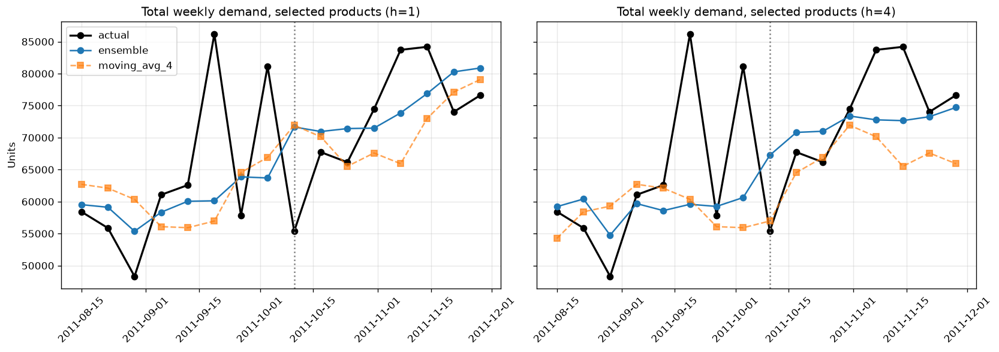

# Demand Forecasting & Inventory Optimization Using Machine Learning

A predictive-analytics workflow that forecasts weekly product demand from historical retail transactions, evaluates the forecasts against simple baselines, and turns them into inventory replenishment recommendations. The results are served through an interactive dashboard and a REST API.

---

## Contents
1. [Business problem](#business-problem)
2. [Dataset](#dataset)
3. [Results at a glance](#results-at-a-glance)
4. [Quick start](#quick-start)
5. [Methodology (four-week plan)](#methodology-four-week-plan)
6. [Dashboard](#dashboard)
7. [API](#api)
8. [Tests](#tests)
9. [Project structure](#project-structure)
10. [Assumptions and limitations](#assumptions-and-limitations)
11. [Future improvements](#future-improvements)

---

## Business problem

Retailers must balance product availability against the cost of holding stock. Inaccurate demand estimates lead to stockouts, missed sales and urgent replenishment, or to excess inventory. This project:

- forecasts weekly demand per product, 1–4 weeks ahead;
- compares the forecasts with naive and seasonal-naive baselines using chronological validation;
- converts the forecasts into reorder points, safety stock and suggested order quantities under stated service-level assumptions;
- presents actual vs forecast demand, forecast error, stockout risk and replenishment suggestions in a dashboard and an API.

## Dataset

| | |
|---|---|
| **Name** | Online Retail, [UCI Machine Learning Repository](https://archive.ics.uci.edu/dataset/352/online+retail) (Chen, Sain & Guo, 2012) |
| **Business** | UK-based online gift retailer; many customers are wholesalers |
| **Period** | 1 Dec 2010 – 9 Dec 2011 (about 12.5 months) |
| **Size** | 541,909 invoice lines, 4,070 stock codes, 38 countries |
| **Fields** | InvoiceNo, StockCode, Description, Quantity, InvoiceDate, UnitPrice, CustomerID, Country |
| **Not included** | Stock levels, stockouts, promotions, supplier lead times, store/location |

The raw file lives in `data/raw/Online Retail.xlsx` and is never edited. It is excluded from Git; download it from the UCI link above.
Field meanings are documented in `reports/data_dictionary.csv`.

## Results at a glance

**Scope:** 978 products forecast at weekly level. They cover 70% of training-period units.
**Selected model:** an equal-weight **ensemble** of XGBoost (Tweedie loss), Random Forest and simple exponential smoothing. It was chosen on the validation period.

**Test period** (8 unseen weeks, 10 Oct – 28 Nov 2011):

| | Ensemble WAPE / Bias | Best baseline (4-week moving average) WAPE / Bias |
|---|---|---|
| Product level, 1 week ahead | **60.6% / +2.3%** | 61.8% / −2.1% |
| Product level, 4 weeks ahead | **65.2% / +1.3%** | 65.8% / −9.1% |
| Total demand, 1 week ahead | **9.4%** | 10.5% |
| Total demand, 4 weeks ahead | **8.0%** | 9.9% |

- **Validation improvement:** on validation, the ensemble improved WAPE over the moving average by 7.0% (h = 1) and 4.7% (h = 4).
- **Test improvement:** on test the gain is smaller (1–2%). Weekly product demand is noisy, and the test period is a pre-Christmas peak the models never trained on.
- **Bias:** the main advantage is **low bias**. The moving average under-forecasts by up to 9%, which would lead to stockouts.
- **Safety stock:** at a 2-week lead time and a 95% target, the safety stock covered **90.8%** of lead-time demand cycles in the test backtest. The gap to target is documented.



## Quick start

**Requirements:** Python 3.11.

```powershell
git clone https://github.com/Aryansgit-web/Demand-Forecasting-Inventory-Optimization-Using-Machine-Learning.git
cd Demand-Forecasting-Inventory-Optimization-Using-Machine-Learning
pip install -r requirements.txt
# put "Online Retail.xlsx" in data/raw/
```

Run the steps in this order:

| Step | Command | Time |
|---|---|---|
| 1. Data quality and EDA | run `notebooks/01_week1_data_quality_eda.ipynb` | ~1 min |
| 2. Features and baselines | run `notebooks/02_week2_features_baselines.ipynb` | ~15 s |
| 3. Models and replenishment | run `notebooks/03_week3_models_replenishment.ipynb` | 5–10 min |
| 4. Tests | `python -m pytest -q tests` (expect `71 passed`) | ~10 s |
| 5. Dashboard | `streamlit run app/dashboard.py` → http://localhost:8501 | — |
| 6. API | `uvicorn api.main:app --reload` → http://127.0.0.1:8000/docs | — |

Run the notebooks from the `notebooks/` folder; VS Code and Jupyter do this by default. The dashboard and the API can run at the same time.

## Methodology (four-week plan)

### Week 1: Data quality and exploratory analysis
`notebooks/01_week1_data_quality_eda.ipynb`, `src/data_cleaning.py`

**Cleaning rules** (`reports/cleaning_log.csv`): 541,909 raw lines became **519,699** clean product sales lines.

| Rule | Lines removed |
|---|---|
| Exact duplicate rows | 5,268 |
| Non-product codes: postage, fees, manual adjustments, gift vouchers | 2,989 |
| Fully cancelled orders. Each order and its matching cancellation are removed together, so cancelled bulk orders (e.g. 80,995 units) don't appear as false demand. | 5,610 |
| Remaining returns, adjustments and zero-price lines | 8,343 |

**Calendar:** the shop never trades on Saturdays and closes over Christmas and UK bank holidays. Those days are treated as closed, not zero demand.

**Weekly table:** a complete weekly product panel is built in `data/processed/weekly_product_demand.csv`.
- Products enter the panel at their first sale, so there are no zeros before launch.
- Closed and partial weeks are flagged.

**EDA findings**
- Demand is flat from January to August, then rises strongly from September to November.
- The UK accounts for about 83% of units.
- Most products have erratic or lumpy demand. Only 316 have smooth demand.

**Outputs:** data dictionary, data-quality report, demand profile, and figures `01–06`.

### Week 2: Feature engineering and baselines
`notebooks/02_week2_features_baselines.ipynb`, `src/splits.py`, `src/features.py`, `src/baselines.py`, `src/evaluation.py`

**Aggregation level and scope:** weekly × product. The data has no store dimension.
- **Scope rule:** products present for the whole training period that sold in ≥80% of training weeks, giving 978 products.
- The rule uses training data only.

**Chronological split** (`reports/split_plan.csv`)

| Split | Weeks | Use |
|---|---|---|
| Train | 2010-12-06 → 2011-08-08 (35) | fitting |
| Validation | 2011-08-15 → 2011-10-03 (8) | tuning and model choice |
| Test | 2011-10-10 → 2011-11-28 (8) | final evaluation, used once |

The closed week (27 Dec 2010) and the partial weeks (29 Nov 2010, 5 Dec 2011) are removed.

**Features** (`reports/feature_dictionary.csv`), 28 per horizon:
- lags, rolling mean/std/max, EWM, intermittency, weeks since last sale
- order counts and a price-change proxy (no promotion data exists)
- product age, plus calendar features: trading days, UK bank holidays, week, month, quarter, weeks to Christmas

**Leakage control:** every demand feature uses data up to the forecast origin (*t − h*) only. `check_no_leakage()` scrambles future values and confirms no feature changes.

**Baselines**
- Naive and the 4-week moving average both run normally.
- Seasonal-naive (52 weeks) is implemented, but its coverage is 0% because the data has no prior year.
- A 4-week seasonal proxy is also included.
- The best baseline is the 4-week moving average.

**Missing dates and stockouts:** zeros in open weeks are treated as true zeros. Stockouts cannot be identified, because the data has no inventory fields.

### Week 3: Models, evaluation and replenishment
`notebooks/03_week3_models_replenishment.ipynb`, `src/models.py`, `src/replenishment.py`, `src/config.py`

**Models:** one direct model per horizon (h = 1–4).

| Family | Variants |
|---|---|
| XGBoost | squared-error, log-target and **Tweedie** loss |
| Random Forest | raw, ratio-to-recent-mean and log targets |
| Simple exponential smoothing | per product, α tuned |
| Ensemble | equal-weight average of the three |

ARIMA and seasonal ETS were not used: each product has only about 35 training weeks and no repeated yearly cycle.

**Selection:** lowest mean validation WAPE among models with |bias| ≤ 10% (`reports/model_tuning.csv`).
- Log-target and L1 models had the lowest WAPE, but they under-forecast by 30–40%, so they were rejected.
- The selected models are refitted on train + validation, then scored once on test.
- Production models are refitted on all weeks and saved in `models/`.

**Evaluation**
- **Metrics:** MAE, RMSE, WAPE (the primary metric, because many weeks are zero), bias, and MAPE on non-zero weeks for reference.
- **Comparison levels:** both product-week and total-demand level.
- **Error analysis:** by product, by week and by demand pattern (`reports/error_by_*.csv`, figures `31–36`).

**Replenishment:** a periodic-review, order-up-to policy.

| Quantity | Formula |
|---|---|
| Lead-time demand | sum of forecasts over the lead time |
| Demand variability σ | RMSE of out-of-sample **cumulative** forecast errors per product (validation) |
| Safety stock | z × σ(lead time + review) |
| Reorder point | lead-time demand + z × σ(lead time) |
| Suggested order | max(0, order-up-to level − inventory position), rounded to pack size, MOQ applied |
| Stockout risk | P(lead-time demand > inventory position), normal approximation |

- **Defaults** (assumptions): 2-week lead time, weekly review, 95% service level.
- **Current stock** is a user input. It is never estimated from the data.
- **Backtest:** `reports/service_level_backtest.csv` checks the service level actually achieved on test.
- **Sensitivity:** `reports/replenishment_sensitivity.csv` shows safety stock across lead times and service levels.

**Forecast outputs**
- `data/processed/forecasts_backtest.csv`: validation and test forecasts for all methods.
- `data/processed/forecasts_future.csv`: forecasts for 5–26 Dec 2011.

### Week 4: Dashboard, API and reporting
`app/dashboard.py`, `api/main.py`, `src/app_data.py`, `tests/`, `docs/API.md`. Details are in the next sections.

## Dashboard

```powershell
streamlit run app/dashboard.py
```

| Page | Content |
|---|---|
| **Demand Overview** | Total weekly actual vs forecast demand, future forecast, forecast error by week, and headline WAPE / bias against a chosen baseline. Filters: horizon, period, baseline, products. |
| **Product Forecasts** | Forecast trajectory and sales history for any product, past forecasts, 4-week future forecast and test error. Warns when demand is falling sharply. |
| **Inventory Risk** | Inputs: lead time, service level, pack size, MOQ. Shows lead-time demand, safety stock and reorder point for every product. With current stock (typed in or uploaded as CSV) it adds the suggested order, reorder-now flag, stockout risk and weeks of cover. Shows the service level achieved in the backtest. Downloadable plan. |
| **Model Performance** | MAE / RMSE / WAPE / bias for all methods against the baselines, at product or total level, plus error by product and by demand pattern. |
| **Assumptions** | Documented assumptions, limitations and how to read the outputs. |

## API

```powershell
uvicorn api.main:app --reload        # interactive docs at http://127.0.0.1:8000/docs
```

| Method | Path | Purpose |
|---|---|---|
| GET | `/health` | Status, selected model, forecast weeks |
| GET | `/products?search=` | Find valid product codes |
| POST | `/forecast` | `{stock_code, horizon 1–4, store="ALL"}` → forecast, weekly path, approximate 90% interval, components, warnings |
| GET | `/forecast/{stock_code}?horizon=` | Same, as a GET request |
| POST | `/replenishment` | `{stock_code, on_hand, on_order, lead_time_weeks, service_level, pack_size, min_order_qty}` → reorder point, safety stock, suggested order, stockout risk |

**Error responses**
- **Invalid input:** 422, listing the field and the problem.
- **Unknown product:** 404, with a hint to use `/products`.
- **Unsupported store:** 422. The data has no store field, so only `ALL` is accepted.

Full usage and examples are in **[docs/API.md](docs/API.md)**.

## Tests

```powershell
python -m pytest -q tests            # 71 tests
```

- **`tests/test_api.py`:**
  - API forecasts match the stored `forecasts_future.csv` for 10 products × 4 horizons.
  - Replenishment matches `src/replenishment.py`.
  - Invalid input returns clear 404 or 422 errors.
- **`tests/test_stored_examples.py`:**
  - The saved models reproduce the stored forecasts.
  - Stored metrics recompute from the stored past forecasts.
  - The model was selected on validation, not test.

## Project structure

```text
Demand-Forecasting-Inventory-Optimization-Using-Machine-Learning/
├── data/                               # not in Git; rebuilt by the notebooks
│   ├── raw/Online Retail.xlsx          # original dataset (never edited)
│   ├── interim/cleaned_sales.csv       # cleaned transactions (Week 1)
│   └── processed/
│       ├── weekly_product_demand.csv   # product × week panel (Week 1)
│       ├── features_h1.csv, features_h4.csv, baseline_forecasts.csv   # Week 2
│       └── forecasts_backtest.csv, forecasts_future.csv               # Week 3
├── notebooks/
│   ├── 01_week1_data_quality_eda.ipynb
│   ├── 02_week2_features_baselines.ipynb
│   └── 03_week3_models_replenishment.ipynb
├── src/                                # reusable code, imported by notebooks, app and API
│   ├── data_cleaning.py                # cleaning rules, weekly panel, demand profile
│   ├── splits.py                       # split dates, horizons, product scope
│   ├── features.py                     # leakage-safe features + leakage check
│   ├── baselines.py                    # naive, moving average, seasonal naive
│   ├── evaluation.py                   # MAE, RMSE, WAPE, bias, MAPE
│   ├── models.py                       # XGBoost / Random Forest / SES / ensemble
│   ├── replenishment.py                # safety stock, reorder point, order quantity
│   ├── config.py                       # all inventory assumptions
│   └── app_data.py                     # shared data access for dashboard and API
├── models/                             # trained production models + model_card.json
├── app/dashboard.py                    # Streamlit dashboard
├── api/main.py                         # FastAPI service
├── tests/                              # pytest suite (71 tests)
├── docs/API.md                         # API setup and usage
├── reports/
│   ├── figures/                        # 01–06 EDA, 21–24 baselines, 31–36 models
│   ├── assumptions.md                  # assumptions and limitations
│   ├── data_dictionary.csv, data_quality_report.csv, cleaning_log.csv, demand_profile.csv
│   ├── split_plan.csv, product_selection.csv, feature_dictionary.csv
│   ├── baseline_evaluation*.csv, baseline_error_by_product.csv
│   ├── model_tuning.csv, selected_models.csv, model_comparison*.csv
│   ├── error_by_product.csv, error_by_week.csv, error_by_demand_class.csv
│   └── replenishment_plan.csv, service_level_backtest.csv, replenishment_sensitivity.csv
├── requirements.txt
├── .gitignore
└── README.md
```

## Assumptions and limitations

All inventory parameters are assumptions set in `src/config.py`. The full list is in [reports/assumptions.md](reports/assumptions.md).

| Assumption | Value |
|---|---|
| Supplier lead time | 2 weeks for every product (configurable 1–3) |
| Review period | 1 week |
| Service level | 95% cycle service level |
| Current stock | user input only; not in the data |
| Pack size / MOQ | 1 / 0 (no supplier data) |

**Limitations**
- **About 12 months of data:** yearly seasonality cannot be learned, and validation and test fall in the autumn ramp-up and the pre-Christmas peak.
- **Noisy product-level demand:** product-level WAPE stays around 60–70%. Totals are far more accurate (8–10%).
- **No stock or stockout history:** if stockouts happened, recorded sales understate true demand and safety stock.
- **No promotion or store data:** only a price-change proxy is used, and forecasts are product-level only.
- **Safety stock below target:** it achieved 90.8% against a 95% target in the backtest. A 99% setting achieves about 94%.
- **Products being phased out:** forecasts lag sharp declines. The dashboard and API flag these for review.
- **Christmas week:** the 26 Dec 2011 forecast assumes 4 trading days, but the shop was closed that week in 2010.

**How to interpret outputs:** treat forecasts as estimates with error. Enter real stock before acting on order quantities, review flagged products manually, and re-run notebooks 01–03 when new data arrives.

## Future improvements

- **More history:** add at least a second year of data, to model yearly seasonality and enable a real seasonal-naive benchmark.
- **Inventory and supplier data:** add stock levels, stockout flags, real lead times, pack sizes and MOQs, to remove the main assumptions and correct demand for stockouts.
- **Promotions and pricing:** use promotion calendars and price plans as forward-looking features.
- **Intermittent demand:** use dedicated methods (Croston / SBA) and an empirical or bootstrap safety stock instead of the normal approximation.
- **Retraining:** schedule automatic retraining and forecast monitoring, and add authentication before deploying the API.

## Tech stack

Python 3.11, pandas, NumPy, scikit-learn, XGBoost, Matplotlib, Plotly, Streamlit, FastAPI, Uvicorn, pytest, Jupyter, Git/GitHub. Versions are in `requirements.txt`.

> Forecasts are model estimates, not ground truth. Inventory outputs depend on documented assumptions (lead time, service level, current stock) that are **not** contained in the dataset. See [Assumptions and limitations](#assumptions-and-limitations).
